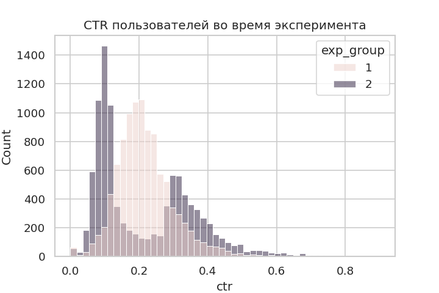
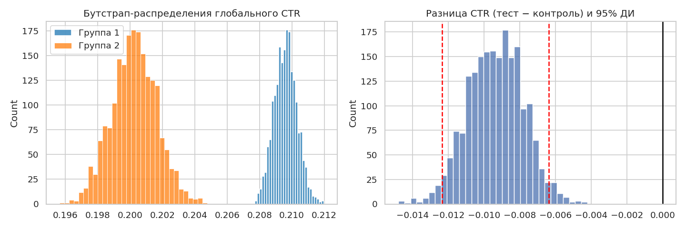
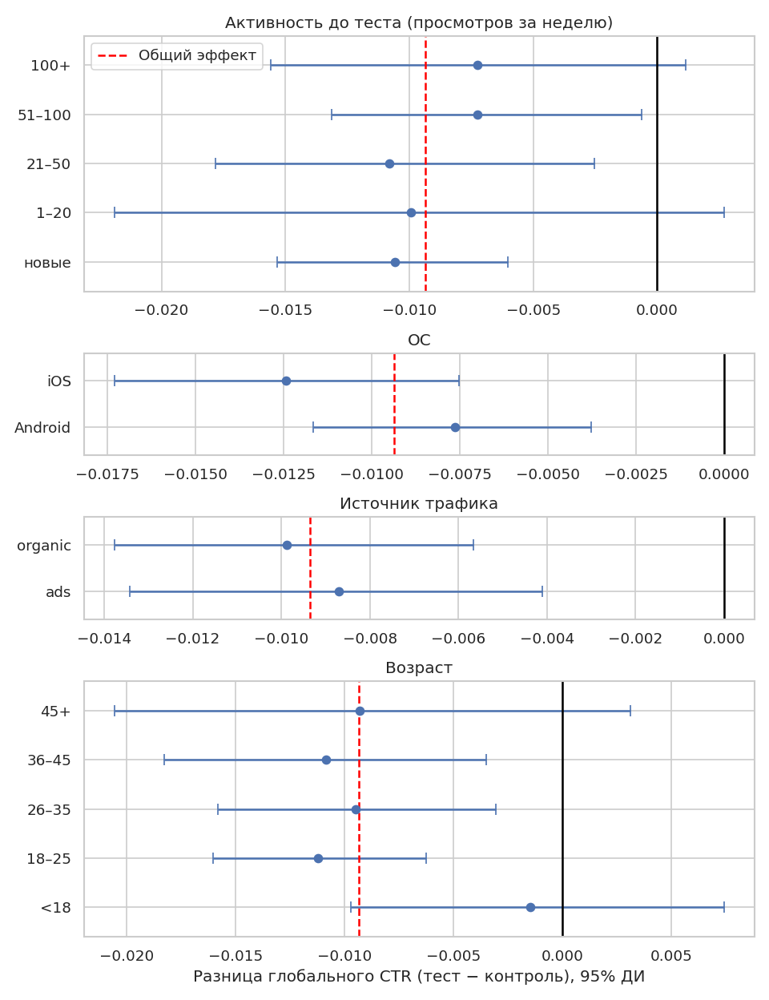
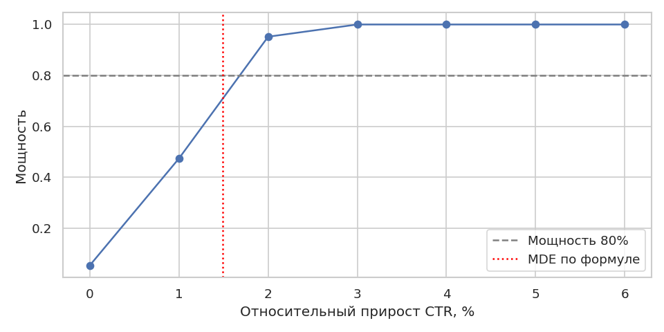

# A/B-тест нового алгоритма рекомендаций в ленте новостей

> Учебный проект, выполненный в рамках обучения в ООО «Карпов Курсы» — [karpov.courses](https://karpov.courses).
> Авторство условий задания и учебных данных принадлежит ООО «Карпов Курсы».

Полный цикл A/B-эксперимента: от постановки гипотезы и расчёта размера выборки до анализа результатов, разбора неоднородного эффекта и решения о раскатке.

**Гипотеза и метрика → Дизайн: MDE и размер выборки → Проверка: A/A и SRM → Анализ A/B → Сегменты → Решение**

## Цель проекта

Оценить, повышает ли новый алгоритм рекомендаций постов вовлечённость пользователей ленты, и принять обоснованное решение: раскатывать его на всех пользователей или нет.

## Задачи проекта

1. Сформулировать гипотезу, выбрать основную, дополнительные и ограничительные метрики.
2. Оценить на исторических данных минимальный обнаружимый эффект (MDE) и мощность теста при фактическом размере групп.
3. Проверить корректность эксперимента: равенство размеров групп (SRM) и однородность групп до теста (A/A).
4. Сравнить контрольную и тестовую группы по основной метрике несколькими методами и объяснить расхождения между ними.
5. Выяснить, у каких пользователей эффект положительный, а у каких отрицательный.
6. Сформулировать решение и следующие шаги.

## Методология и инструменты

**Основная метрика** — глобальный CTR группы:

$$CTR = \frac{\sum likes}{\sum views}$$

В отличие от среднего CTR пользователей, глобальный CTR взвешен по просмотрам и показывает долю лайков среди всех показов, то есть именно то, на что влияет алгоритм. Дополнительные метрики — распределение пользовательского CTR и CTR по бакетам. Ограничительные метрики — просмотры и лайки на пользователя.

| Этап | Методы |
|---|---|
| Дизайн | MDE по формуле для линеаризованной метрики, кривая мощности методом симуляции (бутстрап реальных пользователей) |
| Проверка сплитования | SRM (критерий хи-квадрат), A/A-тест и A/A-симуляция с оценкой доли ложных срабатываний |
| Анализ | t-тест Уэлча, тест Манна–Уитни, t-тест на линеаризованных лайках, пуассоновский бутстрап, бакетный анализ |
| Сегменты | эффект с бутстрап-интервалами по активности до теста, ОС, источнику трафика и возрасту, поправка Бонферрони |

**Инструменты:** Python (pandas, NumPy, SciPy, matplotlib, seaborn), SQL (ClickHouse), Jupyter.

## Источники данных

Учебная база данных ООО «Карпов Курсы»: логи действий пользователей ленты новостей (просмотры и лайки постов) с номером экспериментальной группы и атрибутами пользователя (ОС, источник трафика, возраст).

- Контроль — группа 1 (старый алгоритм), тест — группа 2 (новый алгоритм).
- Период до эксперимента: 21.08–27.08, период эксперимента: 28.08–03.09.

Данные и доступ к базе в репозиторий не включены. Запросы, по которым данные выгружаются, лежат в папке `sql/`.

## Результаты и выводы

**Корректность эксперимента.** До запуска алгоритма группы однородны по CTR (p-value A/A-теста ≈ 0.80), критерий не завышает долю ложных срабатываний.

**Основной результат.** Новый алгоритм статистически значимо **снизил** глобальный CTR: с ≈ 0.21 до ≈ 0.20. 95%-й доверительный интервал разницы (тест − контроль), полученный бутстрапом, — [−0.014; −0.005]. Он целиком лежит в отрицательной зоне.

**Почему методы расходятся.** Распределение CTR в тестовой группе стало бимодальным: у меньшей части пользователей CTR вырос (пик около 0.3), у большинства снизился (пик около 0.1).

- t-тест на среднем CTR пользователей не видит разницы (p ≈ 0.69): рост и падение частично уравновешивают друг друга.
- Тест Манна–Уитни показывает, что распределения сильно различаются (p < 0.001), но не говорит о направлении.
- Линеаризация и бутстрап проверяют именно основную метрику и показывают значимое снижение.

**Неоднородность эффекта.** Бимодальность означает, что алгоритм подходит небольшой группе пользователей и ухудшает выдачу для остальных. Разбор по сегментам — в разделе 3 ноутбука `02_ab_test_analysis.ipynb`.

**Решение: не раскатывать новый алгоритм на всех пользователей.**

## Визуализация

Распределение CTR пользователей во время эксперимента:



Бутстрап-распределения глобального CTR и разница между группами:



Эффект по сегментам с 95%-ми доверительными интервалами:



Кривая мощности, полученная на этапе дизайна:



## Применение результатов

- Решение о раскатке: алгоритм не выкатывается, что предотвращает падение вовлечённости и возможный отток аудитории.
- Сегменты с ростом CTR подсказывают, для какой аудитории алгоритм работает и в какую сторону его дорабатывать.
- Ноутбук дизайна и функции из `src/ab_utils.py` можно переиспользовать для следующей итерации: пересчитать MDE и размер выборки, проверить сплитование и проанализировать новый тест по той же схеме.

## Ограничения и сложности

- **Метрика-отношение.** CTR пользователей с разным числом просмотров нельзя просто усреднять, а наблюдения внутри пользователя зависимы. Решение — линеаризация и пуассоновский бутстрап на уровне пользователя.
- **Бимодальное распределение.** Стандартный t-тест на среднем CTR пользователей дал ложное «нет эффекта». Поэтому вывод опирается на несколько методов, а их расхождение объяснено.
- **Расчёт мощности.** В первой версии симуляция генерировала лайки поверх уже наблюдённого CTR, учитывала шум дважды и занижала мощность. Кроме того, размер группы брался как половина всех пользователей ленты, а не фактический размер групп. Обе ошибки исправлены, симуляция сверена с аналитической формулой.
- **Смещение при сегментации.** Если делить пользователей по активности во время теста, сам алгоритм влияет на попадание в сегмент. Поэтому активность берётся за неделю до эксперимента.
- **Множественные сравнения.** При большом числе сегментов растёт риск случайных находок. Применена поправка Бонферрони, а сегментные выводы считаются гипотезами для следующего теста, а не доказанным фактом.
- **Короткий период.** Эксперимент длился неделю, поэтому эффект новизны и долгосрочное влияние на удержание не оценены. Гипотезу о влиянии времени суток имеющиеся разрезы не проверяют.

## Структура репозитория

```
ab-testing-feed-algorithm/
├── README.md
├── requirements.txt
├── .env.example                     шаблон переменных подключения (без значений)
├── notebooks/
│   ├── 01_experiment_design.ipynb   гипотеза, метрики, MDE, мощность
│   └── 02_ab_test_analysis.ipynb    SRM, A/A, A/B, сегменты, решение
├── src/ab_utils.py                  общие функции и параметры эксперимента
├── sql/                             запросы для выгрузки данных
├── data/
└── images/                          графики для README
```

## Запуск

```bash
pip install -r requirements.txt
cp .env.example .env
```

Заполните `.env` параметрами подключения к своей базе ClickHouse с аналогичной структурой таблицы `feed_actions` и запустите ноутбуки из папки `notebooks/` по порядку. Файл `.env` исключён из репозитория через `.gitignore`.
